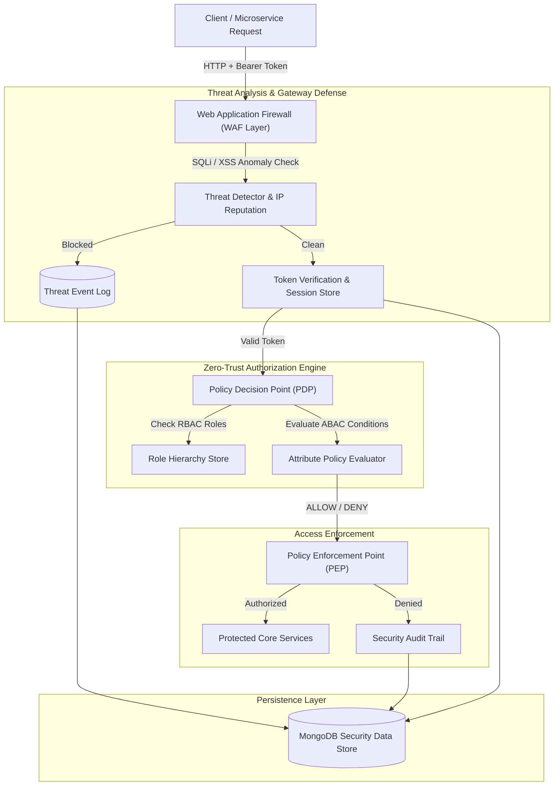

# 🛡️ CyberShield — Zero-Trust Identity, Multi-Tenant RBAC/ABAC Policy Engine & API Gateway Security Platform

[](https://nodejs.org)
[](https://expressjs.com)
[](https://mongodb.com)
[](https://reactjs.org)
[](https://docker.com)
[](https://opensource.org/licenses/MIT)

**CyberShield** is an enterprise Zero-Trust Identity and Access Management (IAM) and API Gateway security platform. Built according to NIST SP 800-207 Zero Trust guidelines, it enforces strict identity verification, evaluates dynamic Attribute-Based Access Control (ABAC) and Role-Based Access Control (RBAC) security policies, performs inline Web Application Firewall (WAF) inspection for SQLi/XSS threats, and provides instantaneous token revocation across distributed API clusters.

---

## 🏛️ System Architecture



---

## ✨ Core Security Capabilities

1. **Dual RBAC & ABAC Policy Decision Point (PDP)**
   - Evaluates composite security policies: principal role, target resource, specific action, and dynamic environmental predicates (e.g., source IP subnet, time of access, MFA presence).
   - Strict `DENY` precedence ensuring explicit security restrictions override ambient grants.

2. **Inline Web Application Firewall (WAF)**
   - Regex-based signature inspection intercepting SQL injection, cross-site scripting (XSS), directory traversal, and command injection before reaching application controllers.
   - Automatic source IP quarantine upon exceeding violation thresholds.

3. **Zero-Trust Token Governance & Revocation**
   - Cryptographically signs and validates session JWTs with unique `jti` identifiers.
   - Stateful blacklist query permits instant, cluster-wide session invalidation upon device compromise.

4. **Cryptographic Integrity & Brute-Force Defense**
   - High-entropy PBKDF2/SHA-256 password hashing with unique 16-byte cryptographically secure salts.
   - Exponential lockout protection after 5 consecutive failed authentication attempts.

---

## 🔌 RESTful API Reference

### 1. Authentication & Session
- `POST /api/auth/register` — Register a new secure user profile with role assignment.
- `POST /api/auth/login` — Authenticate credentials, record device fingerprint, and receive signed JWT.
- `POST /api/auth/revoke-session/:id` — Immediately revoke an active token session cluster-wide.
- `GET /api/auth/sessions` — List active sessions associated with user account.

### 2. Policies & Roles
- `GET /api/policies` — List active ABAC and RBAC security policies.
- `POST /api/policies` — Define a new access policy with conditional rules.
- `POST /api/policies/evaluate` — Test simulation: evaluate access for a specific principal, resource, and action.
- `GET /api/roles` — Retrieve role definitions and permission scopes.

### 3. Threat Monitoring & WAF
- `GET /api/threats` — Query live threat events filtered by severity (`CRITICAL`, `HIGH`).
- `POST /api/threats/block-ip` — Manually quarantine a malicious IP address.
- `POST /api/threats/unblock-ip` — Release an IP address from quarantine.

### 4. Cryptographic Discovery
- `GET /.well-known/jwks.json` — Public JSON Web Key Set discovery endpoint.

---

## 🧪 Automated Test Suite

CyberShield features 7 automated test suites verifying critical security invariants:

```bash
# Execute test suites
npm test

# Run tests with code coverage analysis
npm run test:coverage
```

### Test Coverage Highlights
- `server/tests/cryptoService.test.js` — Salt uniqueness, PBKDF2 hash verification, and key entropy.
- `server/tests/jwtManager.test.js` — Token issuance, expiration verification, and revocation enforcement.
- `server/tests/policyEngine.test.js` — ABAC condition evaluation, RBAC inheritance, and DENY precedence.
- `server/tests/threatDetector.test.js` — WAF detection for SQL injection and XSS payload signatures.
- `server/tests/ipReputation.test.js` — Brute-force violation thresholding and automatic quarantine.
- `server/tests/auth.test.js` — Account lockout after failed login attempts.
- `server/tests/e2eZeroTrustLifecycle.test.js` — Complete lifecycle: Registration -> Auth -> Policy evaluation -> WAF threat -> Revocation.

---

## 🚀 Quickstart & Installation

```bash
# 1. Clone repository
git clone https://github.com/developertdsl-prog/cybershield.git
cd cybershield

# 2. Install dependencies
npm install
cd client && npm install && cd ..

# 3. Configure environment
cp .env.example .env

# 4. Seed initial security roles, admin user, and policies
npm run seed

# 5. Start API development server
npm run dev
```

---

## 📄 License
Licensed under the [MIT License](LICENSE). Designed & Maintained by `developertdsl-prog` (<developer.tdsl@gmail.com>).
